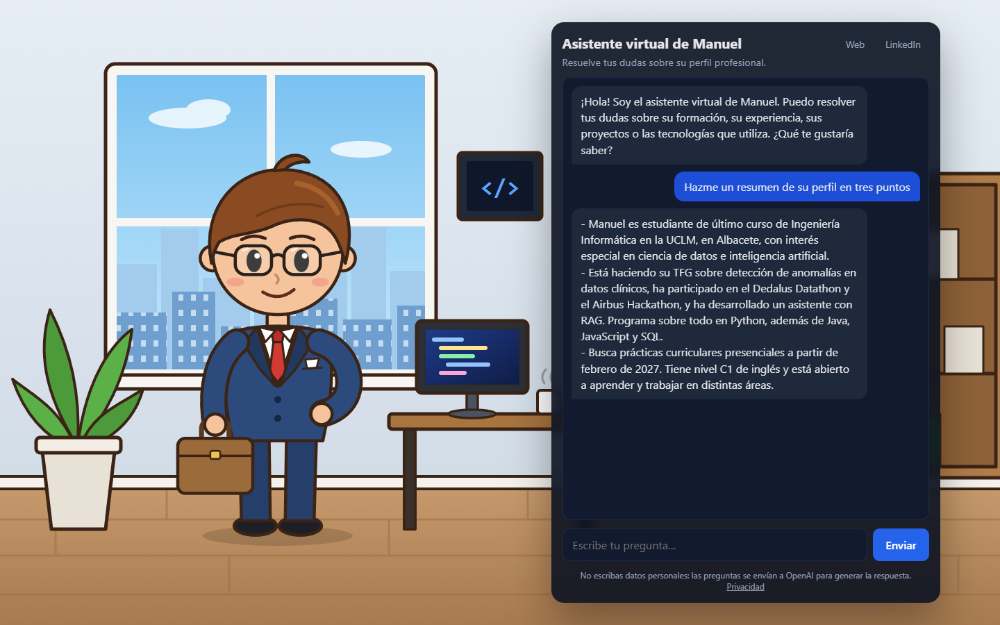

# Asistente virtual de Manuel

Chatbot que responde preguntas sobre mi perfil profesional (formación, experiencia, proyectos y tecnologías) usando solo información sobre mí. El objetivo del proyecto era aprender a construir una aplicación con RAG de principio a fin, partiendo de lo que aprendí en el curso de IA para Desarrolladores de la UCLM, y aparte, poder montar algo que pudiese probar todo el mundo que entre en mi página personal.

**Demo:** https://manuelmoratalla-chatbot.vercel.app



## Cómo funciona

Usa RAG (generación aumentada por recuperación):

1. Mis documentos (`data/*.md`) se dividen en fragmentos, uno por sección, y se convierten en embeddings con OpenAI. El resultado se guarda en `index/index.json` (`npm run index`).
2. Cuando llega una pregunta, se calcula su embedding y se compara con el de cada fragmento (similitud coseno). Se eligen los más parecidos y, si varios son del mismo documento, se añaden los demás fragmentos de ese tema.
3. El modelo recibe unas normas y esos fragmentos, y responde solo con esa información.

En las preguntas de seguimiento ("¿Y en qué año fue?"), la búsqueda usa también la pregunta anterior, y el modelo recibe las últimas tres preguntas con sus respuestas.

## Tecnologías

- **Backend:** Node.js y Express 5.
- **Frontend:** HTML, CSS y JavaScript, sin frameworks.
- **IA:** API de OpenAI, para las respuestas y los embeddings.
- **Límites de uso:** Upstash Redis.
- **Despliegue:** Vercel, con su firewall y Vercel BotID.

## Estructura

```
app.js          rutas de Express y orden de las comprobaciones
server.js       arranca el servidor en local
lib/            lógica del servidor: búsqueda, prompt, OpenAI, límites, validación y BotID
public/         la página del chat
scripts/        crear el índice y depurar preguntas
data.example/   un perfil inventado para probar el proyecto
```

## Probarlo en local

Hace falta Node.js 22.9 o superior y una clave de la API de OpenAI.

```bash
git clone https://github.com/manumoratalla/chatbot-cv.git
cd chatbot-cv
npm install
```

1. Copia `.env.example` como `.env` y pon tu clave en `OPENAI_API_KEY`. Las variables de Upstash son opcionales en local: sin ellas, los contadores de uso se guardan en memoria.
2. Copia la carpeta `data.example/` como `data/`. Es un perfil inventado.
3. Crea el índice y arranca el servidor:

   ```bash
   npm run index
   npm run dev
   ```

4. Abre http://localhost:3000.

| Comando | Qué hace |
|---|---|
| `npm run dev` | Arranca el servidor y lo reinicia al guardar cambios |
| `npm start` | Arranca el servidor |
| `npm run index` | Crea `index/index.json` a partir de `data/` (llama a OpenAI) |
| `npm run index:preview` | Muestra los fragmentos sin llamar a OpenAI |
| `npm run ask -- "pregunta"` | Muestra qué fragmentos encuentra la búsqueda y la respuesta |

### Con tus propios datos

- Escribe un archivo `.md` por tema, con `# Título` al principio y una sección `## ` por cada fragmento (más detalles en `data.example/LEEME.txt`).
- Cambia el nombre en `public/index.html`, en el saludo de `public/chat.js` y en `public/privacidad.html`.
- Cada vez que cambies los documentos, vuelve a ejecutar `npm run index`.

## Despliegue

Está publicado en Vercel con su CLI (`vercel --prod`). Necesita estas variables de entorno: `OPENAI_API_KEY`, `UPSTASH_REDIS_REST_URL`, `UPSTASH_REDIS_REST_TOKEN` e `IP_HASH_SECRET`. Con `.vercelignore`, los documentos no se suben: solo el índice ya generado.

Fuera de Vercel (por ejemplo, en Render) funciona igual con dos cambios:

- Quitar `<script type="module" src="botid.js"></script>` de `public/index.html`, porque BotID solo existe en Vercel.
- Definir `TRUST_PROXY` con el número de proxies que haya delante del servidor, para que los límites usen la IP real.

## Seguridad y gasto

- **Firewall de Vercel** (una regla en su panel): limita cuántas preguntas por minuto puede enviar cada IP.
- **Vercel BotID:** rechaza las peticiones que no vienen de un navegador.
- **Límites diarios con Upstash:** 20 preguntas por IP y 300 en total. La IP se guarda seudonimizada con HMAC.
- **Límite de gasto mensual** en el proyecto de OpenAI.
- **Validación en el servidor:** mensajes y historial, con tamaño máximo y tiempos máximos de espera.
- **Prompt:** solo permite hablar del perfil y no hace caso de instrucciones para cambiar de papel.
- **Cabeceras de seguridad** (CSP, `X-Frame-Options`…), y los mensajes se pintan como texto, nunca como HTML.

Si Upstash o BotID fallan, el chat sigue funcionando y el límite de gasto de OpenAI acota el coste. Cada pregunta cuesta unos 0,0002 $.

## Decisiones

- **Express en vez de funciones de Vercel o Next.js:** el mismo código funciona en local, en Render o en Vercel.
- **Frontend sin frameworks:** quería entender bien los fundamentos.
- **Índice en un JSON en vez de una base de datos vectorial:** son unas decenas de fragmentos, y compararlos todos tarda menos de un milisegundo.
- **Sin streaming:** las respuestas son cortas.

## Privacidad

Mis documentos (`data/`) y el índice no están en este repositorio. Qué datos trata el asistente: [aviso de privacidad](https://manuelmoratalla-chatbot.vercel.app/privacidad.html).

## In English

A virtual assistant that answers recruiters' questions about my professional profile. It uses RAG: my documents are split into chunks and embedded with OpenAI, each question retrieves the most relevant chunks, and the model answers only from them. Node.js and Express backend, plain HTML, CSS and JavaScript frontend, deployed on Vercel with usage limits (Upstash), bot protection (Vercel BotID) and a spending cap on OpenAI. Live demo: https://manuelmoratalla-chatbot.vercel.app

## Licencia

MIT. El archivo `public/vendor/botid-client-core.js` es código de Vercel BotID, también con licencia MIT.
